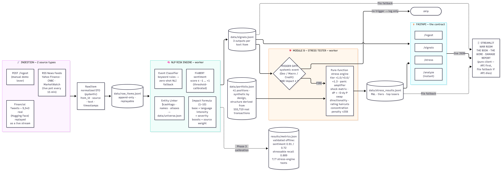

# WAR ROOM — Event-Driven NLP Risk Engine for Wholesale Portfolio Stress Testing

### S&P Global & Crisil Campus Hackathon 2026

* **Candidate Name:** Sparsh Pawar
* **College Email ID:** p.sparsh@iitg.ac.in
* **College / Campus:** IIT Guwahati
* **Demo Video Link:** [YouTube Unlisted Video Link] *(YouTube, unlisted)*
* **Slide Deck Link:** Included in this repo at `docs/presentation.pdf`

---

## 1. Project Overview / Problem Statement & Approach

Financial risk teams drown in unstructured text — news wires, social media — while their
risk systems only speak the language of structured data. The gap between "everyone is
talking about a credit crisis" and "what does that do to _our_ book, right now" is filled
by slow, manual interpretation. This project closes that gap end to end.

**WAR ROOM** is a two-part platform:

1. **AI/NLP Risk Engine (core deliverable).** A streaming pipeline that ingests text from
   two source types — live financial news (RSS: Yahoo Finance, CNBC, MarketWatch) and a
   social feed (9,543 real financial tweets replayed as a live stream) — and converts every
   item into three structured, machine-readable signals:
   - **Sentiment score** in [−1, +1] (FinBERT, threshold-calibrated on two labeled benchmarks)
   - **Event classification** (Geopolitical / Macroeconomic / Credit Event / Merger-Acquisition /
     Product Launch / Earnings-Results / Other) via deterministic keyword rules with a
     zero-shot NLI fallback
   - **Impact score** (1–10): a fully explainable formula combining event-class severity,
     language intensity, severity-word boosts, and source credibility (news > social)

   Signals are exposed via **FastAPI** (`/analyze`, `/ingest`, `/signals`, `/stress`) and
   append-only JSONL logs.

2. **Module B: Event-Driven Portfolio Stress Testing.** Engine signals drive a stress tester
   on a synthetic wholesale-banking portfolio whose _structure is derived from a real
   transaction dataset_ (555,719 transactions — sector weights, position counts and exposure
   sizes come from the data, not hand-picking). When a **systemic** event scores
   **impact ≥ 7**, a severity-tiered shock scenario (Moderate / Severe / Extreme, amplified
   by panic sentiment) is applied through per-asset-class transmission channels: bond
   duration math (dP = −D·dy·P), swap directionality, FX exposure, rating haircuts, and a
   concentration penalty on sectors above 25% of the book.

Design philosophy: **"static brain, dynamic memory."** Models are frozen and validated
offline against labeled ground truth; signal state updates live as text streams in. Every
module is a pure function or an append-only log — deterministic, replayable, unit-tested
where it matters most (the stress engine's math: 7/7 tests).

## 2. Architecture & Tech Stack



**Data flow** (all JSONL logs are append-only, replayable, human-inspectable):

```text
RSS news ──┐
HF tweets ─┼─▶ RawItem ─▶ data/raw_items.jsonl ─▶ ENGINE WORKER ─▶ data/signals.jsonl
POST /ingest┘   (normalized DTO)                    FinBERT · entity     │
                                                    linker · classifier  │ trigger: systemic
                                                    · impact formula     ▼ event + impact ≥ 7
                       data/portfolio.json ────────────────▶ STRESS WORKER ─▶ data/stress_results.jsonl
                       (derived from 556k real txns)        (pure function, 7 unit tests)

data/signals.jsonl ──┐
data/stress_results ─┼─▶ FastAPI (/analyze /ingest /signals /stress) ─▶ Streamlit WAR ROOM
```

**Key architectural decisions**

| Decision                                  | Rationale                                                                                                                               |
| ----------------------------------------- | --------------------------------------------------------------------------------------------------------------------------------------- |
| Append-only JSONL as transport            | Crash-safe, replayable backtests, observable via `tail`. In production this is a Kafka topic — streaming-shaped design with zero infra. |
| API-first, dashboard as pure client       | The dashboard never imports engine code; if the API dies it degrades to reading the logs directly.                                      |
| Stateless idempotency                     | Both workers dedup by ID read from the logs themselves — restart-safe, no state file to corrupt.                                        |
| Hybrid classification (rules → zero-shot) | Deterministic and fast for known patterns; graceful ML fallback for novelty; degrades to rules-only if the model can't load.            |
| Explainable impact score                  | Every point of the 1–10 traces to visible constants — a risk instrument, not a black box.                                               |
| Data-derived portfolio                    | Sector weights from real transaction volumes; provenance committed in `data/portfolio_derivation.json`.                                 |

**Tech stack:** Python 3.12 · FastAPI + Uvicorn · Streamlit <<<STREAMLIT_VER>>> + Plotly ·
Hugging Face Transformers (ProsusAI/FinBERT, facebook/bart-large-mnli) · PyTorch (CPU) ·
pandas · feedparser · pytest · yfinance

## 3. Dataset Used

All datasets are public; sources and licenses declared below (guidelines §9). No proprietary
or confidential data is used anywhere.

| Dataset                                                                              | Role                                                          | Source & License                                                                             |
| ------------------------------------------------------------------------------------ | ------------------------------------------------------------- | -------------------------------------------------------------------------------------------- |
| **Financial PhraseBank v1.0** (4,840 sentences; 16 finance-domain annotators)        | News-domain sentiment benchmark                               | Malo et al. (2014), CC BY-NC-SA 3.0 — _in-distribution_ for FinBERT; reported as upper bound |
| **Twitter Financial News Sentiment** (9,543 tweets; 0=bearish, 1=bullish, 2=neutral) | Social-domain sentiment benchmark + social ingestion source   | Hugging Face `zeroshot/twitter-financial-news-sentiment`                                     |
| **Sparkov Credit Card Transactions** (fraudTest.csv, 555,719 transactions)           | Portfolio derivation: sector weights from transaction volumes | Kaggle `kartik2112/credit-card-fraud-detection`, CC0 Public Domain                           |
| **Curated demo headlines** (data/demo_feed.jsonl)                                    | Deterministic demo choreography only                          | Self-written synthetic                                                                       |
| **Golden event set** (data/golden_events.jsonl, 37 items)                            | Event-classifier ground truth                                 | 30 curated synthetic + 7 blind-labeled real signals                                          |
| **Historical backtest events** (5 events, 2022–2024)                                 | Impact validation vs realized market moves                    | Curated headlines; realized moves via `yfinance`                                             |

**Declared assumptions & processing:**

- Conflicting PhraseBank duplicate annotations deduped by majority vote
  (`scripts/prepare_phrasebank.py`); the parse is gated by a parsed-vs-raw sanity check.
- Portfolio: 28% Financials anchor (card data contains no financial-sector spend);
  asset-class mix, ratings, durations, coupons, derivative directions/notionals (20x value)
  are seeded, declared assumptions. Counterparties come from `data/universe.json`, shared
  with the engine's entity linker (one namespace across signals and book). Full provenance:
  `data/portfolio_derivation.json`.
- RSS analysis is headline/summary-level (a stated limitation); the social feed is
  _replayed_ as a live stream (Twitter/X API is paid) — the same pattern production systems
  use for backfill.
- Data minimization: only `category` + `amt` columns are read from the transaction dataset;
  demographic columns are never processed.
- Citation: Malo, P., Sinha, A., Korhonen, P., Wallenius, J., & Takala, P. (2014). _Good debt
  or bad: Detecting semantic orientations in economic texts._ JASIST, 65(4), 782–796.

## 4. Quickstart & Installation

**Runtime:** Python 3.12 on Windows 11 (tested). Linux/macOS work with the standard venv
activation syntax.

```bash
git clone [<<<REPO_URL>>>](https://github.com/sparshpawar22/IITGuwahati_Sparsh_Pawar_Hackathon)
cd IITGuwahati_Sparsh_Pawar_Hackathon
python -m venv .venv
.venv\Scripts\activate          # macOS/Linux: source .venv/bin/activate
pip install -r requirements.txt
```

**Run the full stack — 4 terminals, in this order:**

```bash
python -m src.engine.worker            # T1: NLP engine worker (FinBERT loads ~15s, then watches the feed)
uvicorn src.api.main:app --reload      # T2: API  -> http://127.0.0.1:8000/docs
python -m src.module_b.worker          # T3: stress trigger worker (41 positions)
streamlit run src/dashboard/app.py     # T4: dashboard -> http://localhost:8501
```

**Try it in 30 seconds** (with T1+T2 running): open `http://127.0.0.1:8000/docs` →
`POST /ingest` →

```json
{
  "text": "BREAKING: Major regional bank defaults on commercial paper, credit spreads widen sharply, contagion fears grip the sector",
  "source": "news"
}
```

T1 prints the analyzed signal (~10s), T3 prints `FIRED`, and the dashboard's **DAMAGE
REPORT** tab fills with the waterfall. That is the whole pipeline, live.

**Useful commands**

```bash
python -m src.engine.worker --once --rules-only                    # one-shot backfill of raw items
python -m src.module_b.worker --simulate Geopolitical 8.5 -0.85    # engine-free stress smoke test
python -m pytest tests/ -v                                         # stress-engine unit tests (7)
python -m src.engine.summary                                       # signal health check
python -m src.module_b.summary                                     # stress-run history
python -m src.ingest.rss --once                                    # fetch fresh news now
python scripts/derive_portfolio.py                                 # rebuild portfolio from transactions
```

**Notes:** the first run downloads model weights (~420 MB FinBERT + ~1.6 GB zero-shot, cached
afterwards; the zero-shot model is lazy — used only when no keyword rule matches). A curated
headline feed exists for deterministic demos:

```bash
python -m src.ingest.replay --file data/demo_feed.jsonl --source social --detail demo_feed --interval 2
```

## 5. Key Results & Domain Impact

_(all numbers reproducible via `scripts/`; consolidated in `results/metrics.json`)_

- **Sentiment (dual-domain validation):** FinBERT accuracy **0.910** on Financial PhraseBank
  (news-domain, in-distribution benchmark, n=500) and **0.720** on HF financial tweets
  (social-domain, out-of-distribution, n=500) — vs a naive lexicon baseline (VADER) at
  **0.614 / 0.578**: a **+29.6 / +14.2 point** gain over the naive approach. One shared
  label threshold (0.50), selected by sweep across both domains, is calibrated into the
  engine. Charts: `results/confusion_*.png`.
- **Event classification:** **0.784** accuracy on a 37-item golden set (30 curated +
  7 blind-labeled real signals); **stressable-event recall = 0.889** — the reliability of
  the Module B trigger. Dominant error mode: Geopolitical ↔ Macro/Earnings bleed on
  ambiguous headlines (full confusion matrix in `results/metrics_events.json`).
- **Impact backtest (5 real events, 2022–2024):** the SVB collapse scored **9.1** (KRE fell
  **−16.2%**); the hot-CPI print scored **6.2** (SPY −4.0%, QQQ −4.7%). By design the score
  measures **systemic severity, not single-stock magnitude**: NVDA's earnings blowout that
  moved its stock **+23.8%** scored only **3.2** — idiosyncratic ≠ systemic, the exact
  distinction risk desks make. Chart: `results/backtest.png`.
- **Stress engine correctness:** 7/7 unit tests, including exact verification of the
  duration formula (dP = −D·dy·P) and swap directionality.
- **Trigger audit:** impact ≥ 7 fires on **3.1%** of live signals (11 of 350: 8 Credit,
  2 Geopolitical, 1 Macro) — selective enough to be meaningful, frequent enough to act on.

**Why it matters:** a risk desk gets an early-warning workflow — text arrives, risk is
priced, and the portfolio's exposure is quantified within seconds, with every number
traceable to a formula and every dataset declared. The terminal-style dashboard reflects
how risk desks actually work: the output of an NLP engine should read like a terminal, not
a science fair.

## 6. Repository Structure

```text
├── README.md  LICENSE (MIT)  requirements.txt
├── src/
│   ├── common/        # DTOs (RawItem, Signal) + append-only JSONL store
│   ├── ingest/        # rss.py · replay.py · gdelt.py (parked) · summary.py
│   ├── engine/        # sentiment · entities · events · impact · analyze · worker · summary
│   ├── api/           # FastAPI service
│   ├── module_b/      # stress engine (pure fn) · trigger worker · summary
│   └── dashboard/     # Streamlit war room
├── scripts/           # data prep · derivation · validation · backtest · repair tools
├── tests/             # pytest suite for the stress engine
├── data/              # committed: portfolio(+provenance), universe, demo/golden feeds,
│                      #   phrasebank.csv, sample_tweets.csv, small logs
│                      #   data/raw/ = full downloads (gitignored; see Dataset Used)
├── docs/              # presentation.pdf · architecture.png
└── results/           # metrics.json · confusion matrices · backtest chart
```

## 7. Limitations & Next Steps

- **Headline-level NLP** — feeds provide headlines/summaries, not full articles.
- **Backtest n=5** — directional methodology validation, not a statistical claim; scaling is
  straightforward because the engine is a pure function.
- **Golden set n=37** — adequate for directional validation; growing it to 100+ items is the
  first calibration task post-hackathon (the labeling tool already exists).
- **Static models** — a feedback loop (recorded signals vs realized moves → recalibration /
  fine-tuning) is designed-for but not implemented; hooks exist in the signal schema and logs.
- **Zero-shot fallback is CPU-slow** (2–5s/item) — mitigated by rules-first routing and
  `--rules-only` bulk mode.
- **GDELT ingestion implemented but parked** (strict per-IP rate limits); RSS is the primary
  news source — a live example of source-agnostic redundancy in the ingestion layer.

---

_Built for the S&P Global & Crisil Campus Hackathon 2026 · simulated exercise, public/synthetic
data only · MIT licensed._
